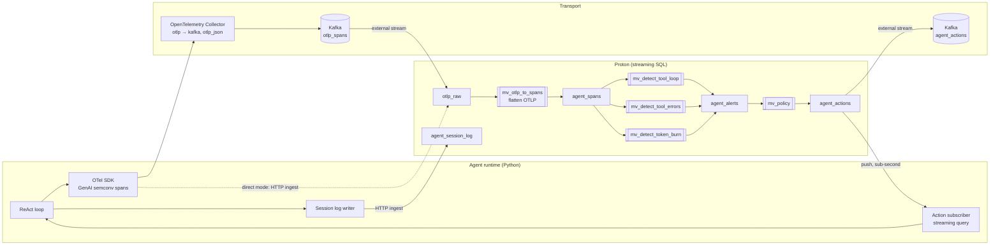

# Architecture

## Data flow

| Step | What | Where |
|---|---|---|
| 1 | The agent emits one span per model call (`chat`), tool call (`execute_tool`), and session (`invoke_agent`) with [OpenTelemetry GenAI semantic conventions](https://opentelemetry.io/docs/specs/semconv/gen-ai/). | `demo/agent/agent.py` |
| 2 | The OTel Collector receives OTLP and writes each batch to Kafka as OTLP/JSON. | `demo/otel-collector/config.yaml` |
| 3 | A Proton external stream reads the topic; a materialized view copies messages into `otlp_raw`. | `demo/sql/05_kafka.sql` |
| 4 | `mv_otlp_to_spans` flattens `resourceSpans → scopeSpans → spans` and lifts GenAI attributes into typed columns. | `demo/sql/02_parse_otlp.sql` |
| 5 | The agent also appends its own session log (goal, decisions, tool calls/results) to `agent_session_log`. | `demo/agent/proton_io.py` |
| 6 | Three detectors run continuously, each with per-session state, and append to `agent_alerts`. | `demo/sql/03_detectors.sql` |
| 7 | The policy view maps alerts to `interrupt` (with a hint) or `halt`. | `demo/sql/04_policy.sql` |
| 8 | The agent holds `SELECT ... FROM agent_actions WHERE session_id = <self>`; Proton pushes each new row. Actions are also published to Kafka for other consumers. | `demo/agent/proton_io.py`, `demo/sql/05_kafka.sql` |

## Detectors

| Detector | Condition | Mechanism | Action |
|---|---|---|---|
| `tool_loop` | same tool + identical arguments 4× in a row | `PARTITION BY session_id` + `lags()` | interrupt + hint |
| `tool_errors` | 3 consecutive failed tool calls | `PARTITION BY session_id` + `lags()` on status code | interrupt + hint |
| `token_burn` | > 20,000 tokens across the last 5 model calls | `PARTITION BY session_id` + `lags()` + `array_sum` | halt |

All three fire **once**, on the event that crosses the threshold.

### Why not time windows?

An earlier version of `token_burn` used `hop(agent_spans, 1s, 10s)`. Two problems showed up immediately:

1. **Late alerts.** A window is emitted when the watermark passes its end, and the watermark advances with *any* event in the stream. When the offending session went quiet, its window stayed open until a different session's spans arrived.
2. **Duplicate alerts.** Overlapping hop windows each crossed the threshold and each emitted an alert — nine halts for one incident.

Per-session row-based state reacts on the offending event itself and fires exactly once. Time windows are still the right tool for the dashboards (`sql/queries.sql`, Q2).

## Two ingest paths, one format

| Mode | Path | When |
|---|---|---|
| `collector` | OTLP/HTTP → Collector → Kafka → Proton | the docker-compose stack; mirrors production |
| `direct` | agent posts OTLP/JSON to Proton's HTTP ingest API (`/proton/v1/ingest/streams/otlp_raw`) | no Docker, no Kafka; a laptop with only the Proton binary |

Both write identical OTLP/JSON into `otlp_raw`, so everything downstream is the same SQL.

## Measured latency (laptop, single node)

- Span arrival → alert row, inside Proton: ~100 ms (`queries.sql` Q7).
- Agent's tool call completes → action received by the agent: ~200–350 ms, most of it the OTel SDK's 200 ms batch delay.
