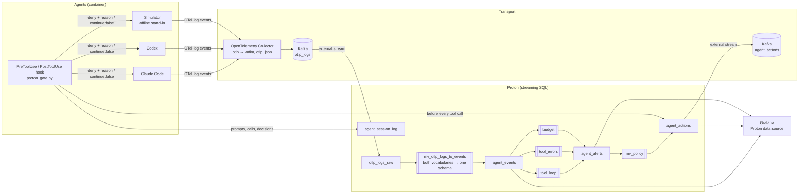

# Architecture

## Why Kafka is in the middle

Proton OSS has no OTLP receiver. Kafka is the bridge: the OpenTelemetry Collector's `kafka` exporter writes OTLP/JSON, and Proton reads the topic with a Kafka external stream. It's also the natural fan-out point — decisions go back out on `agent_actions` for anyone else to consume.

## Data flow

| Step | What | Where |
|---|---|---|
| 1 | Claude Code and Codex export OpenTelemetry **log events** for every tool call and model call. | `docker-compose.yml` (Claude Code env), `agents/codex/config.toml` |
| 2 | The Collector writes each batch to Kafka as OTLP/JSON. | `otel-collector/config.yaml` |
| 3 | A Kafka external stream reads the topic into `otlp_logs_raw`. | `sql/05_kafka.sql` |
| 4 | One materialized view flattens `resourceLogs → scopeLogs → logRecords` and maps both agents' vocabularies onto `agent_events`, including a normalized `call_target` (the shell command minus `sleep N &&`, or the file path). | `sql/02_parse_otlp_logs.sql` |
| 5 | Three detectors keep per-session state and append to `agent_alerts`. | `sql/03_detectors.sql` |
| 6 | The policy view maps alerts to `interrupt` or `halt`, with the text the model will read. | `sql/04_policy.sql` |
| 7 | Before every tool call the agent's `PreToolUse` hook reads new `agent_actions` rows for its session (one ~2 ms HTTP query). Interrupt → this call is denied and the hint is the reason the model sees. Halt → calls are denied and `PostToolUse` returns `continue: false`. | `hooks/proton_gate.py` |
| 8 | The hook also appends prompts, calls, and decisions to `agent_session_log`. | `hooks/proton_gate.py` |

## The two agents, one schema

| `agent_events` column | Claude Code (`claude_code.*`) | Codex (`codex.*`) |
|---|---|---|
| `session_id` | `session.id` | `conversation.id` |
| `event` | `tool_result`, `api_request`, … | `tool_result`, `sse_event`, … |
| `tool_args` | `tool_input` (needs `OTEL_LOG_TOOL_DETAILS=1`) | `arguments` |
| `success` | `success` | `success` |
| tokens | `input_tokens`, `output_tokens` | `input_token_count`, `output_token_count` |
| `cost_usd` | `cost_usd` | — (budget falls back to tokens) |

## Detectors

| Detector | Condition | Mechanism | Action |
|---|---|---|---|
| `tool_loop` | same tool + same target 4× in a row | `PARTITION BY session_id` + `lags()` | interrupt + hint |
| `tool_errors` | 3 failed tool calls in a row | `PARTITION BY session_id` + `lags()` | interrupt + hint |
| `budget` | session spend crosses `$BUDGET_USD` or `BUDGET_TOKENS` | `PARTITION BY session_id` + running sum via `lags()` | halt |

All fire **once**, on the event that crosses the threshold.

### Why per-session row state, not time windows

An earlier version used a sliding 10-second window for spend. Windows close when the watermark passes, and the watermark advances with *any* event in the stream — so one session's alert waited for another session's events, and overlapping windows fired the same alert nine times. Per-session row-based state reacts on the offending event itself and fires exactly once. Windows are still right for dashboards.

### Why the target, not the raw arguments

Agents rewrite the free-text parts of a tool call on every attempt — Claude Code's Bash `description`, a different `sleep` before the same command. Comparing raw arguments misses the loop; comparing the normalized target (`./check_deploy.sh`) catches it.

## Why the decision is applied in a hook

The agent is the thing that's misbehaving, so detection lives outside it, in the stream. But the decision has to land *inside* the agent's loop, at a point where the model will read it. Both Claude Code and Codex call a `PreToolUse` hook before every tool call and pass its denial reason to the model as the tool's result — the cheapest place to put a sentence in front of the model at exactly the right moment, without modifying the agent.

## Measured latency (single node, local)

- Event arrives in Proton → alert row: ~100 ms.
- Agent's event leaves the agent → decision readable by the hook: well under a second (OTel export interval 500 ms for Claude Code, Collector batch 200 ms, Kafka, Proton).
- The hook applies it at the agent's next tool call — which is seconds later, because the model is thinking.
