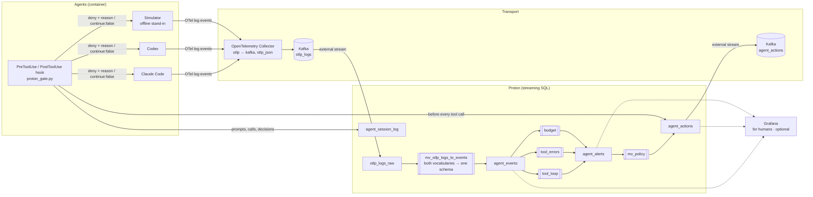

# Architecture



## Two readers of the same stream

The pipeline has two consumers, and only one of them is required:

| Branch | Reader | Path | Needed for the loop? |
|---|---|---|---|
| **The loop** | the agent | `agent_actions` → PreToolUse hook → deny / `continue:false` | **Yes** — this is the loop |
| **Monitoring** | humans | streams → Grafana dashboards | No — remove Grafana and the loop still works |

Classic observability has only the second branch. The point of this demo is the first: the agent reads decisions derived from its own telemetry, before its next tool call, with no human in the path.

## Why Kafka is in the middle

Proton OSS has no OTLP receiver. Kafka is the bridge: the OpenTelemetry Collector's `kafka` exporter writes OTLP/JSON, and Proton reads the topic with a Kafka external stream. It's also the natural fan-out point — decisions go back out on `agent_actions` for anyone else to consume.

## Data flow

| Step | What | Where |
|---|---|---|
| 1 | Claude Code and Codex export OpenTelemetry **log events** for every tool call and model call. | `docker-compose.yml` (Claude Code env), `agents/codex/config.toml` |
| 2 | The Collector writes each batch to Kafka as OTLP/JSON. | `otel-collector/config.yaml` |
| 3 | A Kafka external stream reads the topic into `otlp_logs_raw`. | `sql/05_kafka.sql` |
| 4 | One materialized view flattens `resourceLogs → scopeLogs → logRecords` and maps both agents' vocabularies onto `agent_events`, including a normalized `call_target` (the shell command minus `sleep N &&`, or the file path). | `sql/02_parse_otlp_logs.sql` |
| 5 | Three detectors keep per-session state and append to `agent_alerts`. | `sql/03_detectors.sql` |
| 6 | The policy view maps alerts to `interrupt` (aimed at one call: its `target`) or `halt`, with the text the model will read. A third failing pattern in a session escalates to `halt`. | `sql/04_policy.sql` |
| 7 | Before every tool call the agent's `PreToolUse` hook makes one lookup in `agent_actions` (~15 ms query; ~0.1 s per tool call including the hook process). Interrupt aimed at *this* call and still fresh → denied once, and the hint is the reason the model sees; any other call runs. Halt → every call is denied and `PostToolUse` returns `continue: false`, until a person resumes. | `hooks/proton_gate.py` |
| 8 | The hook also appends prompts, calls, and decisions to `agent_session_log`. | `hooks/proton_gate.py` |

## The two agents, one schema

| `agent_events` column | Claude Code (`claude_code.*`) | Codex (`codex.*`) |
|---|---|---|
| `session_id` | `session.id` | `conversation.id` |
| `event` | `tool_result`, `api_request`, … | `tool_result`, `sse_event`, … |
| `tool_args` | `tool_input` (needs `OTEL_LOG_TOOL_DETAILS=1`) | `arguments` |
| `success` | `success` | `success` |
| tokens | `input_tokens`, `output_tokens` | `input_token_count`, `output_token_count` |
| `cost_usd` | `cost_usd` | — (budget falls back to tokens) |

## Detectors

| Detector | Condition | Mechanism | Action |
|---|---|---|---|
| `tool_loop` | same tool + same target 4× in a row (again on every 4th: 8×, 12×, 16×, ...) | `PARTITION BY session_id` + `lags()` | interrupt + hint |
| `tool_errors` | 3 failed tool calls in a row (again at 6, 9) | `PARTITION BY session_id` + `lags()` | interrupt + hint |
| `budget` | session spend reaches `$BUDGET_USD` or `BUDGET_TOKENS` (again at 2×, 3×, …) | `PARTITION BY session_id` + running sum via `lags()` | halt |

Each fires **once per threshold**, on the event that crosses it (the loop detector on every 4th identical call, so a policy view created late still gets an alert within four calls). The policy turns the third failing pattern in a row into a halt: an agent that ignores two hints is stopped at the 12th identical call or the 9th failure.

## How a decision reaches the agent

**Detection is asynchronous; enforcement is synchronous and local.** The materialized views write decisions into `agent_actions` in the background. The hook never waits for them: before each tool call it makes one lookup — *is there a decision for this session that applies to this call?* — and applies what is already there.

```
call N finishes ─▶ OTel event (≤0.5 s batch) ─▶ Collector ─▶ Kafka ─▶ Proton views (~0.1 s) ─▶ agent_actions
                                                                                                 │
model thinks for its next step (seconds)  ─▶  call N+1: PreToolUse lookup ◀───────────────────────┘
```

Consequences, by design:

- **A decision applies to the next matching call, never to the call that triggered it.** The 4th identical check runs; the 5th is blocked. Patterns across calls are seen after the fact anyway.
- **It is aimed.** An interrupt carries the normalized target of the call it is about. The hook asks Proton to normalize the incoming call with the same `agent_call_target()` the detectors use, and blocks only on a match. If the agent has already moved on, its call runs.
- **It is used once and expires.** An interrupt blocks one matching call, and is ignored after `PROTON_GATE_INTERRUPT_TTL_S` (60 s), so a lagging pipeline can't block an unrelated call later.
- **It escalates.** The third failing pattern in a session is a halt.
- **Failures are contained.** If a view stops, no new decisions appear and the agent runs normally. If Proton is unreachable or slow, the hook gives up after `PROTON_GATE_TIMEOUT_S` (1.5 s) and allows the call. A halt the hook already knows about still stands.
- **What it can't do:** stop a dangerous *first* call (`rm -rf`, reading a secret). Single-call rules belong in the hook or the agent's own permissions, where they are checked synchronously; patterns across calls belong in the stream.

| | Where | Waits? | Good for |
|---|---|---|---|
| Single-call rules | hook / agent permissions | yes, on the agent's path | never run X, never touch Y |
| Patterns across calls | streaming SQL | no, background | loops, retry storms, spend, drift |

### Recovering from a halt

A halt stops the session on purpose and does not clear itself. A person lifts it:

- in the session: type a prompt containing **`[resume]`** — the hook sees it on `UserPromptSubmit`, before the model does, so the agent can't resume itself;
- as an operator: `scripts/resume.sh <session_id>`.

Both write a `resume` row to `agent_actions`, so the audit trail shows who resumed and when; pending interrupts for the session are voided. The budget re-arms at the next multiple, so a resumed session gets one more budget's worth before the next halt.

### Why per-session row state, not time windows

An earlier version used a sliding 10-second window for spend. Windows close when the watermark passes, and the watermark advances with *any* event in the stream — so one session's alert waited for another session's events, and overlapping windows fired the same alert nine times. Per-session row-based state reacts on the offending event itself and fires exactly once. Windows are still right for dashboards.

### Why the target, not the raw arguments

Agents rewrite the free-text parts of a tool call on every attempt — Claude Code's Bash `description`, a different `sleep` before the same command. Comparing raw arguments misses the loop; comparing the normalized target (`./check_deploy.sh`) catches it.

## Why the decision is applied in a hook

The agent is the thing that's misbehaving, so detection lives outside it, in the stream. But the decision has to land *inside* the agent's loop, at a point where the model will read it. Both Claude Code and Codex call a `PreToolUse` hook before every tool call and pass its denial reason to the model as the tool's result — the cheapest place to put a sentence in front of the model at exactly the right moment, without modifying the agent.

## Measured latency (single node, local)

- Event arrives in Proton → alert row: ~100 ms.
- Agent's event leaves the agent → decision readable by the hook: well under a second (OTel export interval 500 ms for Claude Code, Collector batch 200 ms, Kafka, Proton).
- The hook applies it at the agent's next tool call — which is seconds later, because the model is thinking.
